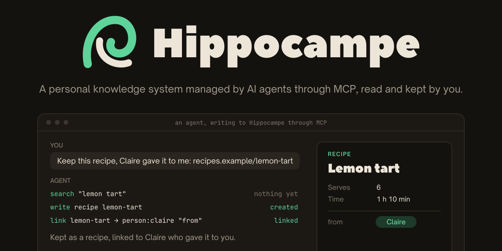
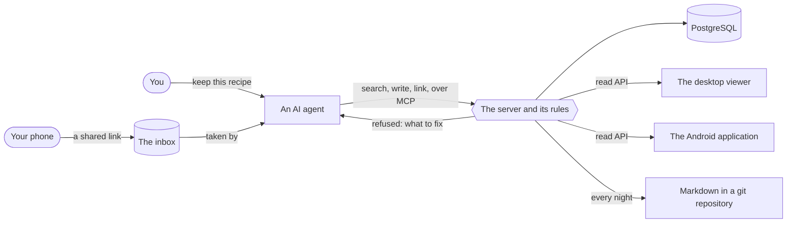
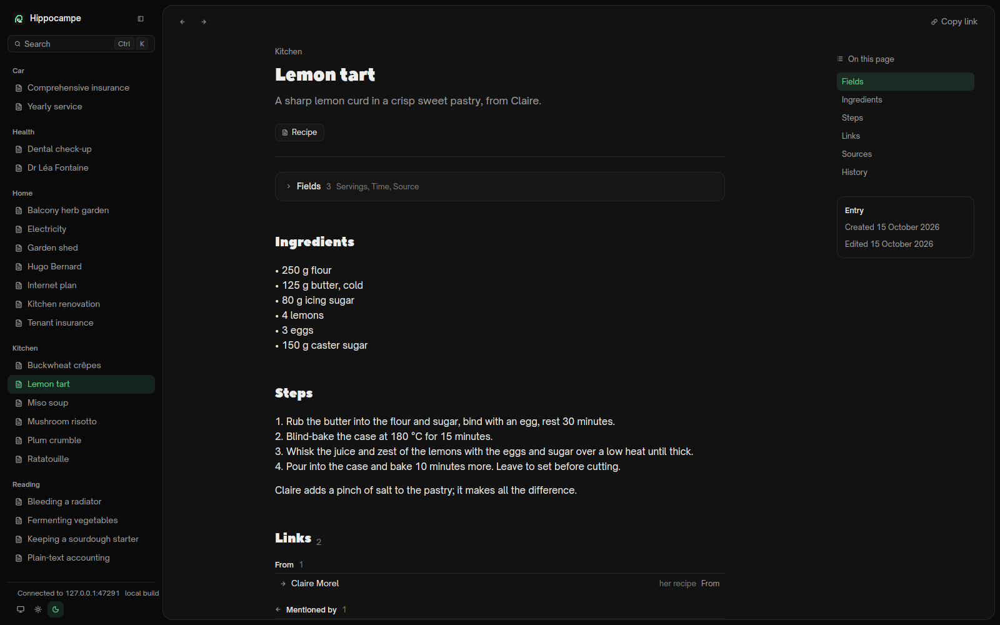
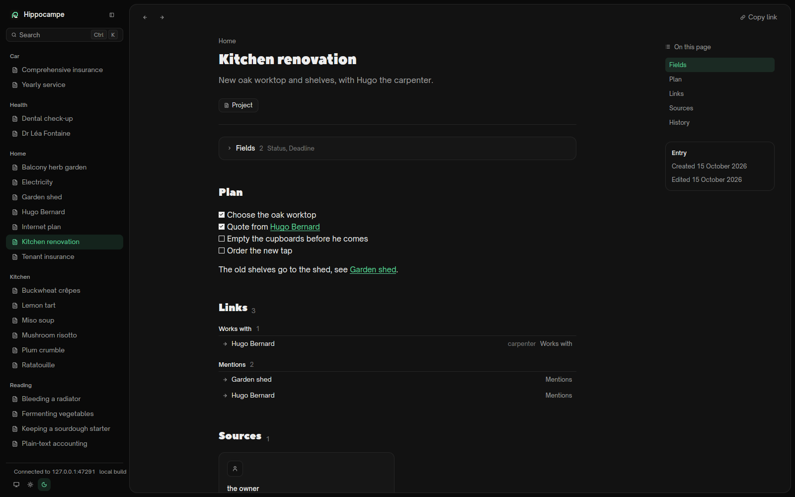
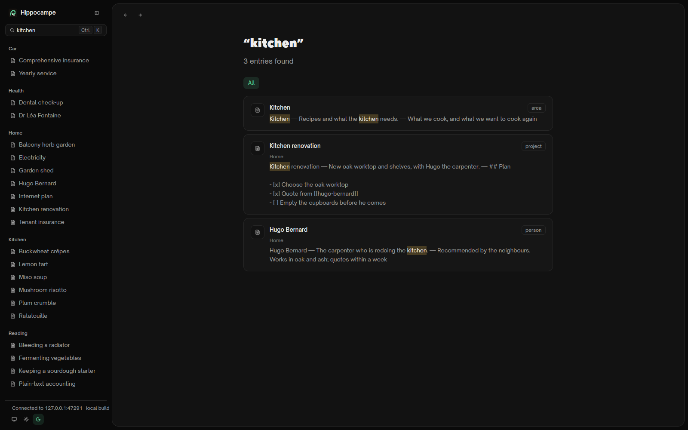
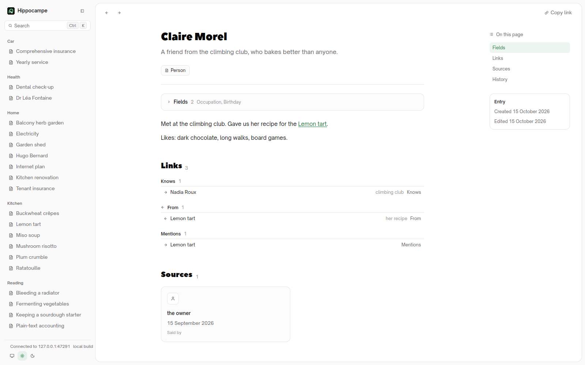
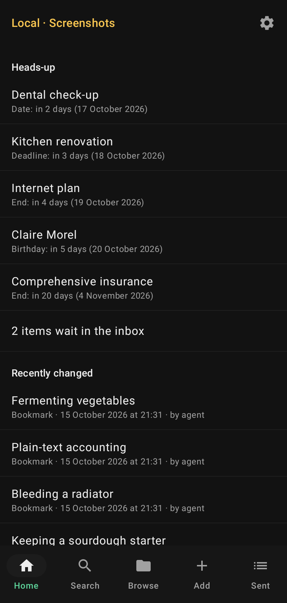
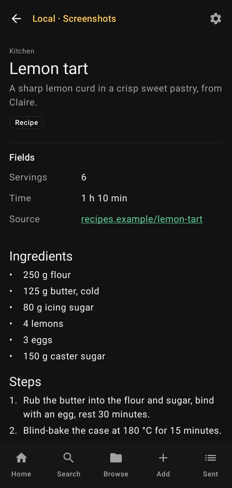
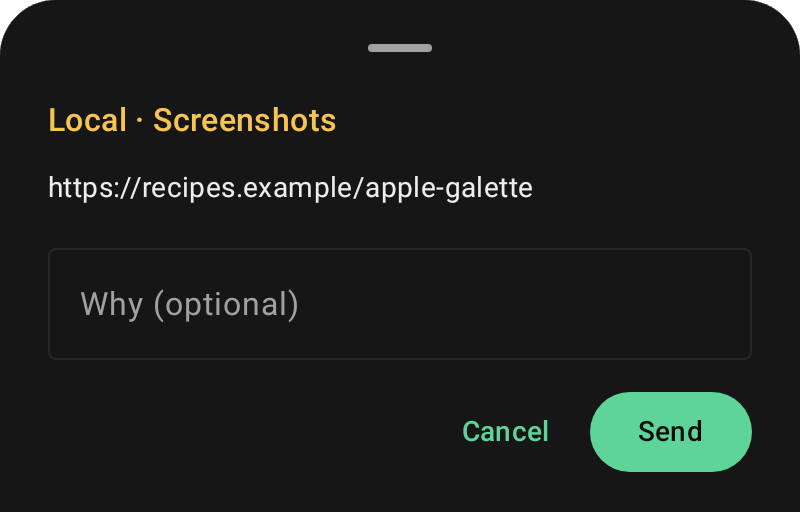

<div align="center">



[](https://github.com/KristenJestin/hippocampe/releases/latest)
[](LICENSE)
[](https://github.com/KristenJestin/hippocampe/actions/workflows/ci.yml?query=branch%3Adev)

</div>

## What it is

A personal knowledge system managed by AI agents through MCP, read and kept by you.

Hippocampe keeps one person's belongings, contracts, people, projects, notes, recipes, bookmarks
and decisions in PostgreSQL. You tell an agent what to keep; it writes it through Hippocampe's MCP
server, which holds every write to the rules; you read the result on the desktop, on the phone, or
in a Markdown export that runs every night into a git repository, so nothing depends on Hippocampe
alone. It is early development, and three rules shape it:

- **Nothing is typed in code.** The system knows generic notions: an entry, its type and fields,
  the entries it is part of, its links, its media, its history. A type such as "recipe" or
  "contract", its fields, and the relations between entries are data, created and changed while it
  runs. [`docs/model.md`](docs/model.md) describes the model.
- **The server runs no AI.** It stores, indexes, validates, searches full text and enforces the
  rules. Every judgement (summarising, linking, deduplicating) comes from an agent, through MCP.
- **The rules live in the server.** A write that breaks a type's definition, a broken link or a
  forbidden change is refused, with a message that says what to fix. Agents are not trusted to
  follow conventions; the server holds them.

## How it works



1. **You say it to an agent** (Claude, Codex, any MCP client), or share it from your phone into the
   inbox, where an agent takes it later.
2. **The agent writes through MCP.** It reads the types and their descriptions, searches before
   creating, writes the entry with where each value comes from (known, or only supposed), and links
   it to the entries it names. When no type fits, it defines one.
3. **The server keeps it honest.** It checks every write against the type, the links and the rules
   of the instance, refuses what breaks them with a sentence that says what to fix, and records who
   wrote what in the history of each entry.
4. **You read it** in the desktop viewer or the Android application (what is due, what waits, the
   tree of entries, each entry with its links), and every night as Markdown files in a git
   repository that you keep.

## The pieces

- **The server and its MCP tools** (`apps/server`): one program that serves the MCP tools over
  HTTP and over stdio, a read API with its OpenAPI document, and an inbox where a text, a link or a
  file waits for an agent to process it. Every request carries a key whose name is the actor of
  its writes. What a version promises: [`docs/versions.md`](docs/versions.md).
- **The desktop viewer** (`apps/desktop`): search, the tree of entries, and each entry with its
  links, on Linux and Windows.
- **The Android application** (`apps/android`): puts things into the inbox from the phone's share
  menu, even offline, and reads what is due, what waits, and the entries.
- **The nightly Markdown export** (`apps/server/src/export`): every entry as a Markdown file,
  committed to a git repository; see [its README](apps/server/src/export/README.md).

## Screenshots

Taken by `bun run screenshots` from a Hippocampe filled with invented data by an agent's MCP calls:
the desktop viewer in a headless Wayland compositor, the Android screens under Robolectric.

| | |
| --- | --- |
|  <br> **An entry**: the tree on the left, a recipe with its fields, its body and its links. |  <br> **Links**: a project, the carpenter it works with and the entries its plan names. |
|  <br> **Search**: full text over titles, summaries and bodies, with the words found. |  <br> **Light theme**: a person, the links to and from her, and who said it. |
|  <br> **Android, home**: the heads-ups and what is due this week, what waits, what changed. |  <br> **Android, an entry**: its fields and its body, read from the server. |
|  <br> **Android, sharing**: a link shared from any application goes to the inbox, even offline. | |

## Install

### On one machine, with npm

`npm i -g @netsirk/hippocampe`, then `hippo service install`: Hippocampe runs as a service of your
session on Linux, with a database of its own, on `127.0.0.1` only. Install, update, uninstall and
where the data is: [`docs/install.md`](docs/install.md). `hippo --help` lists every command.

### With Docker

Server and database in one `docker compose up -d`, on a machine or on a server: start, configure,
save, update, in [`docs/docker.md`](docs/docker.md). (`docs/install.md` is the npm package as a
service; it is not the page of a Docker installation.)

### The desktop viewer

Each release carries the viewer for Linux and Windows. On Linux, one script installs it and updates
it, with no GitHub account:

```
curl -fsSL https://raw.githubusercontent.com/KristenJestin/hippocampe/main/apps/desktop/scripts/update.sh | sh
```

The archives, what the script does and what it never touches, and Windows: [`docs/desktop.md`](docs/desktop.md).

### The Android application

Each release carries `hippocampe-android-<version>.apk`, and a beta for the development instance is
published at each push to `dev` (a pre-release tagged by its version, such as `v0.14.2-beta.21`).
Installing one and pairing it with a server: [`docs/android.md`](docs/android.md).

## Contributing

[`AGENTS.md`](AGENTS.md) says how the repository works, for people and for coding agents.

## Licence and credits

Free software under the [AGPL-3.0](LICENSE). The logo and the banner are in
[`assets/brand`](assets/brand/README.md); the banner draws its tool calls in JetBrains Mono, under the
SIL Open Font License 1.1 ([`assets/brand/fonts`](assets/brand/fonts/README.md)).
The desktop viewer embeds two fonts under the SIL Open Font License 1.1, Open Sauce Sans and Peace
Sans: see [`apps/desktop/assets/fonts`](apps/desktop/assets/fonts/README.md).
